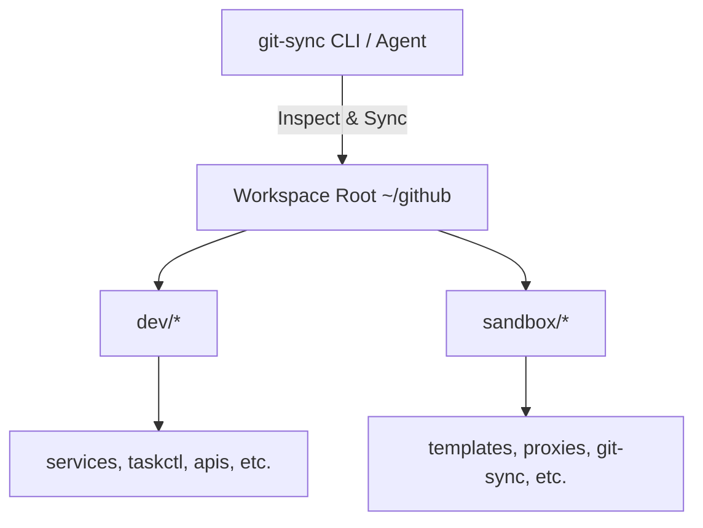

# ECOSYSTEM.md — Multi-Repo Topology & Satellite Registry

> Defines the topology of the satellite repositories and how `git-sync` interacts with them.

---

## Topology Overview

`git-sync` acts as a central workspace orchestrator. Its operational scope covers the configured workspace root (e.g. `~/github`, `~/workspace`):

---

## Workspace Groups

| Group | Path | Purpose |
|---|---|---|
| `dev` | `<root>/dev` | Production services, active infrastructure, daily automation tools |
| `sandbox` | `<root>/sandbox` | Prototyping, proof-of-concepts, templates, satellite agents |

---

## Invariant Boundaries

- `git-sync` performs **read-only status audits** and **non-destructive fast-forward pulls (`--ff-only`)**.
- It **never** force-pushes, discards unstaged files, or performs destructive resets across managed repositories.
