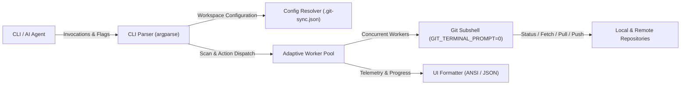

# git-sync

Concurrent multi-repository status auditor and synchronization CLI tool for Git workspaces.

**[English](README.md)** | **[Português (Brasil)](README.pt-br.md)**

[](https://github.com/yegear1/git-sync/actions)
[](LICENSE)
[](https://www.python.org/)

---

## Overview

git-sync manages bulk Git repository operations across multi-project developer workspaces. It inspects local branch divergence, upstream commits, uncommitted working tree changes, and unpushed commits in parallel, replacing repetitive manual inspection loops with a single deterministic command.

Built specifically for high-throughput developer workflows and autonomous AI agents (such as Google Antigravity), git-sync supports both human-readable ANSI terminal output and token-dense JSON payloads designed to minimize context token consumption and latency.

- **Concurrent Inspection:** Scans 30+ repositories in ~2 seconds using a managed `ThreadPoolExecutor` worker pool with adaptive concurrency tuning.
- **Zero External Runtime Dependencies:** Implemented entirely using Python 3.10+ standard library modules (`argparse`, `subprocess`, `concurrent.futures`, `json`, `dataclasses`).
- **Interactive Hang Prevention:** Injects `GIT_TERMINAL_PROMPT=0` and configurable execution timeouts (default: 20s) across all Git subprocesses to prevent orphaned background tasks.
- **Fast-Forward Safety Invariants:** Enforces `--ff-only` by default on all pull operations and atomically updates auxiliary tracking branches without disruptive worktree switching.
- **Autonomous Agent Payloads:** Emits compact JSON summaries via `--json` and filtered outputs via `--pending` to isolate pull/push/dirty repositories with minimal token overhead.

## Architecture



## Quickstart

### Prerequisites

- Python 3.10 or higher (standard library only)
- Git 2.25 or higher

### Setup & Run

```bash
# 1. Clone the repository
git clone https://github.com/yegear1/git-sync.git
cd git-sync

# 2. Install executable into ~/.local/bin
PYTHONPATH=src python3 -m git_sync.cli install
# Alternatively, run the installer script:
# ./scripts/install.sh

# 3. Enable shell autocompletion (optional)
git-sync completion bash --install  # For Bash
git-sync completion zsh --install   # For Zsh

# 4. Verify installation and run local smoke check
git-sync status --no-fetch
```

## Configuration

### Environment Variables

| Variable | Description | Default | Required |
| :--- | :--- | :--- | :--- |
| `GIT_SYNC_ROOT` | Base directory containing Git repositories | `~/github`, `~/Github`, `~/src`, or `.` | No |
| `GIT_SYNC_CONFIG` | Explicit path to JSON workspace configuration file | `~/.git-sync.json` or `~/.config/git-sync/config.json` | No |
| `XDG_CONFIG_HOME` | XDG base directory for configuration resolution | `~/.config` | No |
| `GITHUB_TOKEN` | Optional GitHub personal access token for higher rate-limits | None | No |

Persistent settings can also be defined per repository or globally using a `.git-sync.json` file in the workspace root or `$XDG_CONFIG_HOME/git-sync/config.json`.

## Usage

```bash
# Inspect all repositories with parallel remote fetch
git-sync status

# Instant local status check (no network calls, < 0.5s)
git-sync status --no-fetch

# Display only repositories with pending pull/push or uncommitted changes
git-sync status --pending

# Emit structured JSON payload for AI agents and automated scripts
git-sync status --pending --json

# Fast-forward pull all repositories with upstream changes
git-sync pull --all

# Pull specific repositories by name
git-sync pull repo-a repo-b

# Dry-run push audit across all repositories with unpushed commits
git-sync push --dry-run --all

# Push pending commits across all repositories
git-sync push --all

# Push commits for specific repositories
git-sync push repo-a repo-b

# List uncommitted or untracked file modifications across all repositories
git-sync dirty

# Prune stale remote-tracking branches
git-sync prune
```

## Development

### Project Structure

```text
├── src/git_sync/       # Core CLI parser, execution engine, UI, and telemetry
│   ├── engine/         # Subshell Git abstraction and adaptive concurrency
│   └── ui/             # Terminal progress reporters and formatting
├── tests/              # Unit and integration test harness
├── scripts/            # Standalone installer and distribution packaging scripts
├── docs/adr/           # Architecture Decision Records
├── .agent/             # AI agent directives, skills, and knowledge cards
├── .env.example        # Environment variable schema template
└── pyproject.toml      # Package metadata and tool configurations
```

### Validation Commands

```bash
# Run unit test harness
python3 -m unittest discover -s tests

# Check syntax and bytecode compilation
python3 -m py_compile src/git_sync/*.py tests/*.py scripts/*.py

# Smoke test CLI execution
python3 -m git_sync.cli status --no-fetch
```

### Packaging & Distribution

```bash
# Build source distribution and binary wheel packages
python3 scripts/build.py

# Audit package metadata and distribution hygiene
python3 scripts/build.py --check-dist

# Clean transient build artifacts
python3 scripts/build.py --clean

# Install local wheel package (or via PyPI: pip install git-sync-cli)
pip install dist/git_sync_cli-*.whl
```

## License

Released under the [MIT License](LICENSE).
