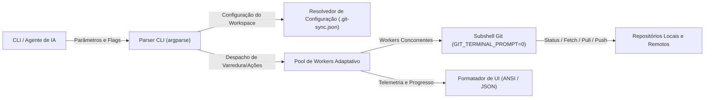

# git-sync

Ferramenta CLI concorrente para auditoria de status e sincronização em lote de múltiplos repositórios Git em workspaces de desenvolvimento.

**[English](README.md)** | **[Português (Brasil)](README.pt-br.md)**

[](https://github.com/yegear1/git-sync/actions)
[](LICENSE)
[](https://www.python.org/)

---

## Visão Geral

O git-sync gerencia operações em lote sobre repositórios Git em workspaces com múltiplos projetos. Ele inspeciona divergências de branches locais, commits upstream, arquivos modificados na working tree e commits pendentes de push em paralelo, substituindo loops manuais de inspeção por um comando determinístico único.

Construído especificamente para fluxos de trabalho de alto rendimento e agentes autônomos de IA (como Google Antigravity), o git-sync oferece saída legível ANSI no terminal e respostas em formato JSON com alta densidade de informação para minimizar o consumo de tokens de contexto e latência.

- **Inspeção Concorrente:** Varre mais de 30 repositórios em ~2 segundos utilizando um pool de workers gerenciado via `ThreadPoolExecutor` com ajuste adaptativo de concorrência.
- **Zero Dependências Externas em Execução:** Implementado integralmente com a biblioteca padrão do Python 3.10+ (`argparse`, `subprocess`, `concurrent.futures`, `json`, `dataclasses`).
- **Prevenção de Travamentos Interativos:** Injeta `GIT_TERMINAL_PROMPT=0` e timeouts de execução configuráveis (padrão: 20s) em todos os subprocessos Git para evitar processos travados em segundo plano.
- **Invariantes de Segurança Fast-Forward:** Aplica `--ff-only` por padrão em operações de pull e atualiza atomicamente branches auxiliares de tracking sem necessidade de alternar a working tree.
- **Payloads para Agentes Autônomos:** Emite resumos em JSON compacto via `--json` e saídas filtradas via `--pending` para isolar repositórios que necessitam de ação com consumo mínimo de tokens.

## Arquitetura



## Início Rápido

### Pré-requisitos

- Python 3.10 ou superior (apenas biblioteca padrão)
- Git 2.25 ou superior

### Instalação e Execução

```bash
# 1. Clonar o repositório
git clone https://github.com/yegear1/git-sync.git
cd git-sync

# 2. Instalar o executável em ~/.local/bin
PYTHONPATH=src python3 -m git_sync.cli install
# Alternativamente, execute o script de instalação:
# ./scripts/install.sh

# 3. Habilitar o autocompletar no terminal (opcional)
git-sync completion bash --install  # Para Bash
git-sync completion zsh --install   # Para Zsh

# 4. Verificar a instalação e rodar checagem local rápida
git-sync status --no-fetch
```

## Configuração

### Variáveis de Ambiente

| Variável | Descrição | Padrão | Obrigatório |
| :--- | :--- | :--- | :--- |
| `GIT_SYNC_ROOT` | Diretório raiz que contém os repositórios Git | `~/github`, `~/Github`, `~/src` ou `.` | Não |
| `GIT_SYNC_CONFIG` | Caminho explícito para o arquivo de configuração JSON | `~/.git-sync.json` ou `~/.config/git-sync/config.json` | Não |
| `XDG_CONFIG_HOME` | Diretório base XDG para resolução de configurações | `~/.config` | Não |
| `GITHUB_TOKEN` | Token de acesso pessoal do GitHub para limites de requisição maiores | Nenhum | Não |

Configurações persistentes também podem ser definidas por repositório ou globalmente via arquivo `.git-sync.json` na raiz do workspace ou em `$XDG_CONFIG_HOME/git-sync/config.json`.

## Uso

```bash
# Inspecionar todos os repositórios com fetch paralelo nos remotes
git-sync status

# Checagem instantânea de status local (sem chamadas de rede, < 0.5s)
git-sync status --no-fetch

# Exibir apenas repositórios com pendência de pull/push ou modificações locais
git-sync status --pending

# Emitir saída estruturada em JSON para consumo por scripts e agentes de IA
git-sync status --pending --json

# Sincronizar via fast-forward todos os repositórios com alterações no remote
git-sync pull --all

# Sincronizar repositórios específicos por nome
git-sync pull repo-a repo-b

# Simulação dry-run de push para repositórios com commits pendentes
git-sync push --dry-run --all

# Enviar commits pendentes de todos os repositórios
git-sync push --all

# Enviar commits de repositórios específicos
git-sync push repo-a repo-b

# Listar alterações não comitadas ou não rastreadas em todos os repositórios
git-sync dirty

# Limpar referências de branches remotas obsoletas (prune)
git-sync prune
```

## Desenvolvimento

### Estrutura do Projeto

```text
├── src/git_sync/       # CLI parser principal, motor de execução, UI e telemetria
│   ├── engine/         # Abstração de subshell Git e concorrência adaptativa
│   └── ui/             # Formatadores e relatores de progresso no terminal
├── tests/              # Suítes de testes unitários e de integração
├── scripts/            # Scripts de instalação global e empacotamento
├── docs/adr/           # Registros de Decisão de Arquitetura (ADRs)
├── .agent/             # Diretrizes de agentes, skills e base de conhecimento
├── .env.example        # Modelo de esquema de variáveis de ambiente
└── pyproject.toml      # Metadados do pacote e configurações de ferramentas
```

### Comandos de Validação

```bash
# Executar a suíte de testes unitários
python3 -m unittest discover -s tests

# Verificar compilação e sintaxe de bytecode
python3 -m py_compile src/git_sync/*.py tests/*.py scripts/*.py

# Teste de execução rápida (smoke test) da CLI
python3 -m git_sync.cli status --no-fetch
```

### Empacotamento e Distribuição

```bash
# Construir pacotes de distribuição fonte (sdist) e wheel binário
python3 scripts/build.py

# Auditar metadados e higiene dos pacotes de distribuição
python3 scripts/build.py --check-dist

# Limpar artefatos de build transitórios
python3 scripts/build.py --clean

# Instalar o pacote wheel localmente
pip install dist/git_sync-*.whl
```

## Licença

Distribuído sob a licença [MIT](LICENSE).
